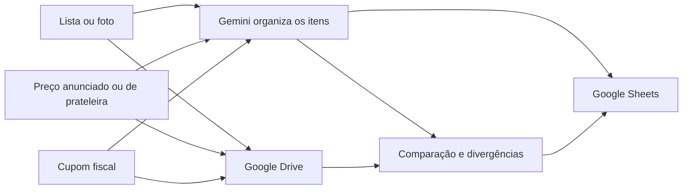

# Fiscal de Compras e Preços

A ideia é conferir se o preço anunciado, o da prateleira e o cobrado no cupom são os mesmos. Fazer isso item por item dá trabalho, e alguma diferença acaba passando.

Montei o MVP para ajudar nessa conferência. Envio as fotos da lista, dos preços e do cupom. O assistente organiza os itens, compara os valores e atualiza o histórico no Google Sheets. As imagens ficam no Google Drive para conferir depois.

Usei um **Gem do Gemini**, **Google Sheets** e **Google Drive**. Aqui deixei a documentação e exemplos com dados fictícios. Os cupons, listas, planilhas e links reais ficam privados.

## O que o MVP faz

- lê listas de compras manuscritas ou impressas;
- extrai produtos de etiquetas, anúncios e cupons fiscais;
- registra quantidade, marca, preço anunciado, preço de prateleira e preço cobrado;
- calcula o total durante a compra;
- aponta promoções que podem não ter sido aplicadas;
- identifica itens duplicados ou que não estavam na lista original;
- mantém um histórico de preços por produto, loja e data;
- preserva a imagem original como evidência, sem levar dados pessoais para a base pública.

Se a imagem estiver ilegível, fica **Precisa confirmar**. Se houver uma possível diferença sem comprovação suficiente, fica **Divergência provável**. A IA ajuda a conferir; não pode inventar um valor nem afirmar cobrança indevida sem evidência.

## Como funciona

O fluxo é esse:

1. fotografar ou enviar a lista;
2. registrar os preços encontrados na loja;
3. enviar a foto do cupom;
4. comparar o anunciado, o valor da prateleira e o valor cobrado;
5. salvar o resultado e atualizar o histórico de preços.

## Organização da planilha

Separei a planilha por compra, itens e divergências:

| Aba | Finalidade |
| --- | --- |
| `Compras` | Identifica a compra e reúne os totais |
| `Itens` | Guarda cada produto e os três preços comparáveis |
| `Historico_Precos` | Permite consultar a evolução do preço |
| `Divergencias` | Registra o que precisa ser conferido |
| `Supermercados` | Padroniza lojas e unidades |
| `Categorias` | Padroniza os grupos de produtos |
| `Abreviacoes_Cupom` | Ajuda a interpretar descrições reduzidas |
| `Regras_Comparacao` | Mantém os critérios da auditoria |

O modelo completo está em [docs/modelo-de-dados.md](docs/modelo-de-dados.md). Os arquivos em [examples](examples) mostram como a exportação funciona com dados inventados.

## Por que fiz assim

- **Planilha como base principal:** era simples de consultar, corrigir e compartilhar sem criar um sistema maior do que o problema.
- **Drive para as evidências:** a planilha guarda os registros e aponta para a imagem usada na conferência.
- **Gemini para leitura e organização:** o Gem recebeu regras específicas para interpretar imagens e devolver dados compatíveis com a planilha.
- **Sem inventar valores:** qualquer leitura duvidosa volta para conferência humana.
- **Promoções condicionais ficam registradas:** aplicativo, CPF, clube, quantidade mínima e ofertas do tipo leve e pague mudam a comparação.
- **Privacidade desde a entrada:** CPF e outros dados pessoais não fazem parte da análise.

As escolhas e os limites atuais estão detalhados em [docs/decisoes.md](docs/decisoes.md) e [docs/limitacoes.md](docs/limitacoes.md).

## Engenharia de prompt

As instruções do Gem seguem a ordem da conferência: identificar a imagem, ler o que está nela, organizar a descrição sem apagar o original, calcular e comparar. Depois, devolver no formato da planilha. Informação que falta continua faltando.

Separei os estados em **OK**, **Precisa confirmar**, **Promoção não identificada** e **Divergência provável**. Assim, uma dúvida de leitura não aparece como uma conclusão fechada.

O desenho das instruções está resumido em [docs/engenharia-de-prompt.md](docs/engenharia-de-prompt.md).

## Situação atual

A estrutura de dados, as regras e o fluxo Gemini → Sheets → Drive estão documentados. A planilha foi preparada para receber os registros e manter o histórico.

Ainda preciso testar mais formatos de cupom, promoções com condições e produtos por peso. Também quero medir quantos itens continuam dependendo de conferência manual.

## Arquivos privados de trabalho

As instruções completas, a planilha pessoal e os materiais de trabalho ficam na governança privada em `projetos-llms` (`~/Documents/Projetos LLMs/05_compras_e_gadgets/fiscal-compras-precos` / [BaianoMaligno/projetos-llms](https://github.com/BaianoMaligno/projetos-llms)). Este repositório público mantém a documentação e os exemplos fictícios.

## Documentação

- [Arquitetura](docs/arquitetura.md)
- [Regras de comparação](docs/regras-de-comparacao.md)
- [Modelo de dados](docs/modelo-de-dados.md)
- [Engenharia de prompt](docs/engenharia-de-prompt.md)
- [Decisões](docs/decisoes.md)
- [Limitações e próximos testes](docs/limitacoes.md)
- [Segurança e privacidade](SECURITY.md)

## Capa da planilha relacionada: Minhas Compras

Minhas Compras é minha planilha de controle pessoal, sem automação de gastos. A capa abaixo não contém os dados dela e pode ser usada no LinkedIn.

## Licença

A documentação e os exemplos deste repositório podem ser usados como referência. Os dados pessoais, cupons, listas e planilhas reais não fazem parte do projeto público.
